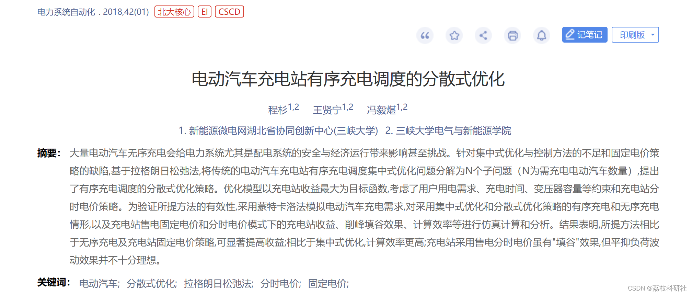
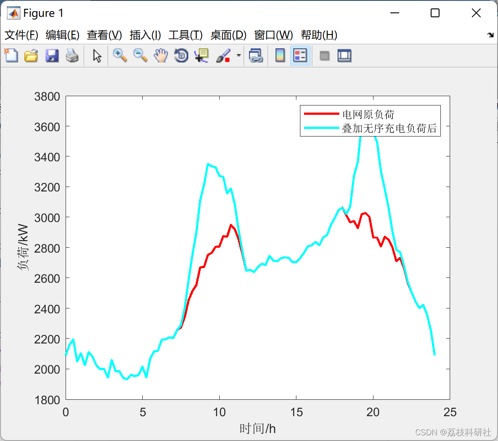
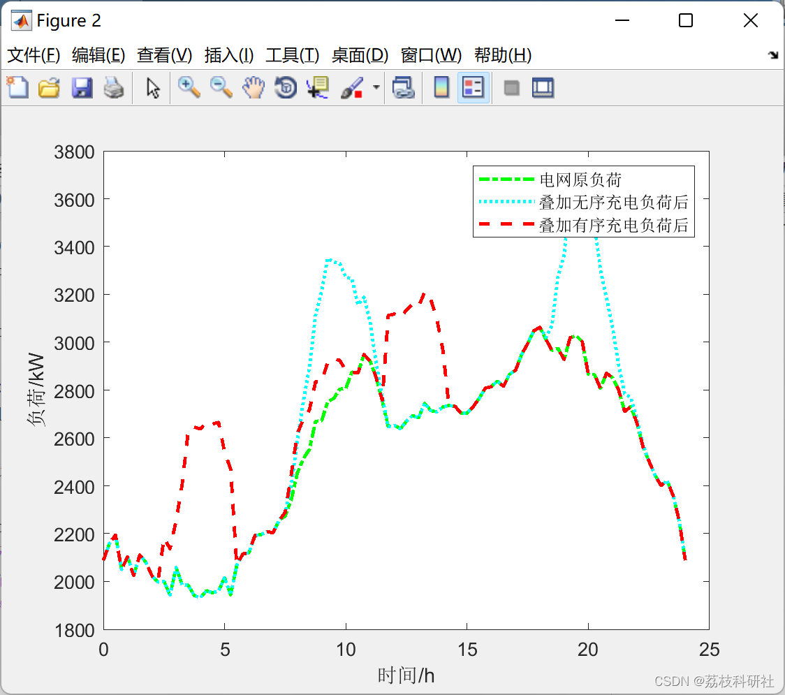

# Distributed Optimization for Ordered Charging Scheduling of Electric Vehicle Charging Stations

Firstly, Monte Carlo simulation is used to simulate the electric vehicle load curve and simultaneously solve for the unordered charging power curve, serving as a basis for comparison with the ordered charging curve. Subsequently, Lagrange relaxation is employed to optimize the scheduling of electric vehicles.
Editor
Abstract: The unordered charging of a large number of electric vehicles can impact the safety and economic operation of the power system, especially the distribution system. Addressing the shortcomings of centralized optimization and control methods and the flaws of fixed electricity pricing strategies, this paper proposes a decentralized optimization strategy for the orderly charging scheduling of traditional electric vehicle charging stations based on Lagrange relaxation. The optimization model aims to maximize the profit of the charging station, considering constraints such as user electricity demand, charging time, transformer capacity, and the charging station's time-of-use pricing strategy. To validate the effectiveness of the proposed method, Monte Carlo simulation is used to simulate the charging demand of electric vehicles. Simulations and analyses are conducted on scenarios with both centralized optimization and decentralized optimization strategies for orderly and unordered charging, as well as on the charging station's revenue, load balancing effect, and computational efficiency under fixed and time-of-use pricing models. Results indicate that compared to unordered charging and fixed pricing strategies for charging stations, the proposed method significantly improves revenue; it also offers higher computational efficiency than centralized optimization. Although the use of time-of-use pricing for charging stations has a "load balancing" effect, its effectiveness in smoothing load fluctuations is not very ideal.
Keywords: Electric vehicles; Decentralized optimization; Lagrange relaxation method; Time-of-use pricing; Fixed pricing;
In high school, I have always heard about Lagrange, a very powerful figure. During my study of SVM, I even encountered his name. Let's learn more about the specific content of Lagrange multipliers.
During the learning process, one may encounter some optimization problems. These optimization problems typically refer to finding the global minimum (whether maxima or minima) of a given function within a specified domain, which are different approaches to solving optimization problems.
Generally, optimization problems encounter the following three types: unconstrained conditions, equality constraints, and inequality constraints. The basic Lagrange multiplier method is the method for finding the extreme value of a function under the constraint conditions. Its main idea is to jointly solve the constraint function with the original function, thereby determining the variables that make the original function achieve its extreme value. The Lagrange multiplier method is used by support vector machines to better solve the problem of distances.
In solving optimal problems, the Lagrange multiplier method (Lagrange Multiplier) and the KKT (Karush Kuhn Tucker) conditions are two most commonly used methods. When there are equality constraints, the Lagrange multiplier method is used; when there are inequality constraints, the KKT conditions are applied.
This article summarizes and applies the Lagrange multiplier method:
(Nonlinear programming in Python) Considering dynamic constraints and energy-saving requirements for economic dispatch in large-scale EV optimization scheduling.
📚2 Run results​
​
This paper mainly studies the application of the distributed optimization strategy based on the Lagrange relaxation method in large-scale EV optimization dispatch, which has higher computational efficiency compared to centralized optimization strategies and is basically not affected by the size of EV dispatches, suitable for real-time dispatch; In terms of achieving maximum profit at charging stations, compared to disordered charging methods, profits are significantly improved; In terms of affecting the load on the distribution network, the use of different electricity pricing strategies by charging stations will have different impacts on the load on the distribution network. When charging stations adopt fixed electricity prices, there is a "filling valley" effect under distributed control modes. Simulation results show that it is extremely important for charging stations to formulate appropriate electricity pricing strategies, which will directly affect the load on the distribution network and the profits of charging stations; In terms of affecting the load on the distribution network, smoothing load fluctuations is not smooth; In studying the Lagrange relaxation algorithm, the selection of initial values affects the convergence speed of the algorithm.🎉3 References  
🌈4 Matlab code, data, article explanation

## Images

<!-- PAYMENT_BLOCK -->

## Get this dataset

- Payment link (Stripe): [Buy now](https://buy.stripe.com/3cs8yP7sY87d0vu9AB)
- Payment QR code: 

<!-- /PAYMENT_BLOCK -->
